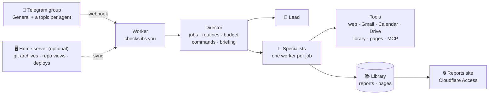

<div align="center">

# 🧑‍✈️ pocketcrew

**A small crew of Claude agents that lives on Cloudflare and works for you from your phone.**

[](https://github.com/dondiegorivera/pocketcrew/actions/workflows/ci.yml)
[](https://github.com/dondiegorivera/pocketcrew/releases)
[](LICENSE)


[Setup](docs/setup.md) · [Using it](docs/using.md) · [Architecture](docs/architecture.md) · [Safety](docs/safety.md) · [Plugins](docs/plugins.md)

</div>

---

You write to a **Lead** in a Telegram group. It hands the work to **specialists** (research, mail, calendar, notes,
your repos, a sales pipeline), each in its own topic, and they report back with short messages, buttons and published
pages. Jobs run in parallel in the cloud, routines run on a schedule in your time zone, and a budget keeps the whole
crew inside the money you give it.

It is meant to stay small: one Worker, a handful of Durable Objects, plain TypeScript, no framework to learn, and every
agent's job written down on one page.

```text
You     ▸ every weekday at 7, the AI news that matters for my projects
Lead    ▸ Saved routine #4 "ai-news": Radar runs it at 07:00 on weekdays, next run tomorrow 07:00.

        ☀️ Tuesday 14 Oct
        📅 Today: 14:00 Dentist
        • ai-news: Two open TTS models beat last month's best · 🔗 page
        • inbox: 12 mails sorted · 1 needs you
        🏷 3 lead decisions waiting · /leads

You     ▸ /leads
Crew    ▸ 🎯 Acme for "Security audit" — launching a public API next month
          [✅ Approve]  [✖ Reject]  [Later]
```

## ✨ What it does

| | |
|---|---|
| 🧭 **A Lead you talk to** | Plain messages or voice notes in General; it plans, dispatches and answers. |
| 👥 **Specialists in topics** | Each agent has a one-page role (what it owns, what it never does) and only the tools it needs. |
| ⚙️ **Jobs and routines** | Parallel jobs on their own workers; routines on a cron in your time zone; a wishlist for quiet days. |
| 📱 **Your phone as the console** | A morning briefing, quiet hours, buttons for decisions (`/inbox`, `/leads`), `/start`, `/today`, `/budget`, `/trace`. |
| 💬 **Reactions as feedback** | ❤️ more like this · 👎 less · ✍ save to notes · 👀 tomorrow · 🤔 say it plainer · 🙈 less of this kind. |
| 📄 **Reports you can read** | HTML pages on a private site behind Cloudflare Access, and a searchable library of every report. |
| 💸 **Paced spending** | Your budget spread over its days, per agent, with a reserve that is never touched. |
| 🧩 **Plugins** | Everything specific to a use is a plugin; turn on what you need. |

## 🏗️ How it works



Every agent is a Durable Object running a [pi](https://github.com/earendil-works/pi) agent harness
on Claude, so a crash or a deploy never loses a conversation. More in [docs/architecture.md](docs/architecture.md).

## 🚀 Quick start

You need a Cloudflare account, an Anthropic API key, Telegram and Node.js 22.

```sh
git clone https://github.com/dondiegorivera/pocketcrew.git
cd pocketcrew
npm run setup
```

`npm run setup` walks you through each step and checks it: Cloudflare sign-in, your settings, a Telegram bot and group,
the secrets, the deploy. Then write anything in the group: the setup checklist (`/start`) takes you the rest of the way.
Plan on about 30 minutes; the full guide is [docs/setup.md](docs/setup.md).

## 🧩 Plugins

| Plugin | Adds | Needs |
|---|---|---|
| `google` | **Mail**, **Calendar**, **Clerk**: triage, labels, drafts, events, Docs and Sheets; `/inbox`, `/google`, `/docs` | a Google OAuth client |
| `web` | **Research**, **Radar**: web search and reading, research MCP servers | — |
| `notes` | **Notes**: Markdown notes by topic, synced to Obsidian over git | a home server |
| `ops` | **Ops**: what changed in your repos, your sites' traffic | a home server for git |
| `lead-pipeline` | **Prospector**, **Closer**: prospects for what you sell, day 0/7/21 drafts, prices; `/leads` | `web` |

Turn them on in `pocketcrew.config.ts`. Writing your own is a folder with a manifest: see
[docs/plugins.md](docs/plugins.md).

## 🛡️ Safe by construction

- **No agent holds your private data, text from strangers and a way out, all at once.** Every tool declares its risks,
  and the build refuses a crew that would combine them.
- **No tool sends email or deletes anything.** Agents write drafts; you send.
- **Private results never reach the Lead as free text,** only as three checked fields, so a mail cannot instruct it.
- **Google goes through one allow-list;** agents never see a token. Secrets live in Cloudflare, never in the repo.

The full model: [docs/safety.md](docs/safety.md).

## 💰 Costs

Model use is billed to your Anthropic key, capped by the budget in `pocketcrew.config.ts`. Cloudflare's free plan runs
a small crew; heavy use may need Workers Paid. Voice notes use Workers AI, which has a daily free allowance.

## 📚 Documentation

| | |
|---|---|
| [Setup](docs/setup.md) | From nothing to a working crew, with a check after every step |
| [Using it](docs/using.md) | Commands, buttons, the briefing, budget and reactions, from the phone |
| [Architecture](docs/architecture.md) | The Worker, the Durable Objects, jobs and the optional home server |
| [Safety](docs/safety.md) | The rules the build enforces, and why |
| [Writing a plugin](docs/plugins.md) | Agents, tools, commands and buttons of your own |
| [AGENTS.md](AGENTS.md) | The map of the code, for people and coding agents |

## 🤝 Contributing

Issues and pull requests are welcome; read [CONTRIBUTING.md](CONTRIBUTING.md) first. Security problems go through
private reporting, see [SECURITY.md](SECURITY.md).

## 📄 License

[Apache-2.0](LICENSE)
